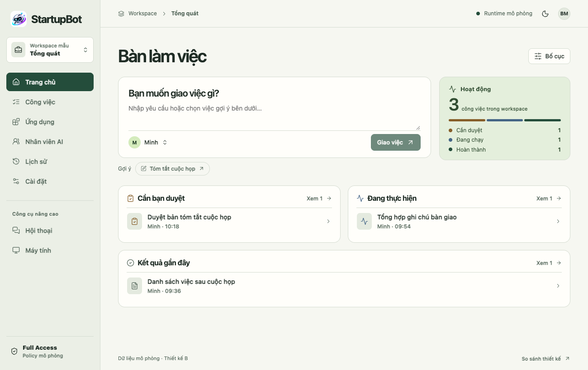

# StartupBot — duyệt thiết kế desktop

**Bản để chủ sản phẩm dùng thử.** Tải [gói HTML ngoại tuyến](StartupBot-preview.zip), giải nén rồi mở `StartupBot.html` bằng Chrome, Edge hoặc Safari. Đã kiểm tương tác trên Chrome/macOS. Trình duyệt lưu dữ liệu thử riêng. Dùng cùng trình duyệt và đường dẫn để mở lại. Có thể chạy bằng HTTP loopback theo hướng dẫn cuối trang.

Mở lần đầu vào **B · Bàn điều hành**. Nâng cao hiện ngay với Hội thoại và Máy tính. Bấm trạng thái Full Access ở cuối thanh bên để xem policy mô phỏng. Bản thử dùng số liệu và nhân viên tổng hợp. Tệp hiển thị trong trình xem của prototype. Adapter, lịch và màn hình máy tính của sản phẩm nằm ngoài bản HTML.



## Ba cách tổ chức công việc

| Phương án | Cách dùng | Lợi ích | Điểm bất tiện | Công sức bảo trì dự kiến |
|---|---|---|---|---|
| A · Sổ công tác | Thanh điều hướng ngang, một trang đọc từ trên xuống, gợi ý và danh sách theo mục | Dễ đọc khi xử lý lần lượt, hợp người cần xem bản nháp dài | Khi nhiều việc đồng thời, cần cuộn để so sánh | Thấp. Một luồng dọc và màn chi tiết xếp dưới danh sách |
| **B · Bàn điều hành** | Giao việc ở trung tâm, sáu điểm đến ở cạnh trái, trạng thái/agent/chi tiết công việc ở ngay cạnh nội dung | Giao việc nhanh và vẫn thấy phần chờ duyệt. Có đường vào chat và máy tính ngay khi mở | Cửa sổ hẹp dành ít chỗ hơn cho hai cột công việc | Vừa. Cần kiểm thanh bên, chế độ một cột, focus và khôi phục điều hướng khi quay lại |
| C · Bảng luồng | Thanh ngang và các cột trạng thái. Bấm thẻ để xem quyết định hoặc kết quả | Nhìn được việc ùn ở bước nào khi có nhiều lượt chạy | Cột dễ dài, nhãn tiếng Việt và màn hình hẹp cần nhiều diện tích | Cao nhất trong ba mẫu. Cần duy trì cột, thứ tự focus, di chuyển giữa thẻ và bố cục trên màn hẹp |

B là phương án được đề xuất theo luồng nghiệm thu từ giao việc tới duyệt và mở kết quả. Bấm **So sánh thiết kế** ở chân trang để chuyển A/B/C. Mỗi phương án có đầy đủ điều hướng.

## Năm lượt thử trước khi duyệt

1. Tại **Trang chủ**, chọn **Tóm tắt cuộc họp**, sửa nội dung rồi nhấn Enter. Shift+Enter xuống dòng. Trong **Công việc**, chờ hoàn thành, mở tệp, mở hội thoại. Mở lại HTML rồi vào **Lịch sử** tìm yêu cầu vừa gửi.
2. Chọn workspace **Kế toán** ở đầu thanh bên. **Đối chiếu hóa đơn** mở yêu cầu sửa được. Kết quả mẫu HD-M01 có chênh lệch 20.000 ₫. Mở **Ứng dụng → MISA mẫu → Chi tiết → Thử yêu cầu ghi mô phỏng** để xem cách hiển thị từ chối. Có thể thử soạn thư ở Kinh doanh và viết bài ở Marketing.
3. Bấm **Full Access → Policy mô phỏng → Yêu cầu duyệt**. Giao hai việc riêng để thử Từ chối và Duyệt. Trong Cài đặt cũng có tình huống runtime từ chối khi gửi, mất kết nối và nối lại. Các công cụ nâng cao vẫn hiện trong các tình huống này.
4. Vào **Bố cục**. Thử ghim, di chuyển bằng các nút mũi tên, ẩn tất cả, đóng dialog bằng Escape rồi khôi phục bố cục. Nhập “Đưa việc cần duyệt lên đầu và ẩn kết quả gần đây”, thử **Xem trước → Hủy**, sau đó thử **Áp dụng → Hoàn tác**. Bộ tạo đề xuất trong bản thiết kế chỉ nhận câu mẫu. Trong **Cài đặt → Đổi mẫu ngành**, đọc thứ tự widget mới trước khi bấm. Đổi mẫu trong cùng workspace giữ công việc và policy.
5. Ở **Nhân viên AI**, chọn Mai để giao việc rồi kiểm danh tính trong hội thoại. Vào **Lịch sử → Ghi chú bàn giao** để tiếp tục hội thoại mẫu cũ. Kiểm thêm giao diện tối, cỡ cửa sổ 840 × 620, thao tác Tab, Enter và Escape.

## Ảnh từng màn hình

| Màn hình | A · Sổ | B · Sáng | B · Tối | C · Bảng |
|---|---|---|---|---|
| Trang chủ | [Xem](screens/A-light-home.png) | [Xem](screens/B-light-home.png) | [Xem](screens/B-dark-home.png) | [Xem](screens/C-light-home.png) |
| Công việc | [Xem](screens/A-light-work.png) | [Xem](screens/B-light-work.png) | [Xem](screens/B-dark-work.png) | [Xem](screens/C-light-work.png) |
| Ứng dụng | [Xem](screens/A-light-apps.png) | [Xem](screens/B-light-apps.png) | [Xem](screens/B-dark-apps.png) | [Xem](screens/C-light-apps.png) |
| Nhân viên AI | [Xem](screens/A-light-agents.png) | [Xem](screens/B-light-agents.png) | [Xem](screens/B-dark-agents.png) | [Xem](screens/C-light-agents.png) |
| Lịch sử | [Xem](screens/A-light-history.png) | [Xem](screens/B-light-history.png) | [Xem](screens/B-dark-history.png) | [Xem](screens/C-light-history.png) |
| Cài đặt | [Xem](screens/A-light-settings.png) | [Xem](screens/B-light-settings.png) | [Xem](screens/B-dark-settings.png) | [Xem](screens/C-light-settings.png) |
| Hội thoại | [Xem](screens/A-light-chat.png) | [Xem](screens/B-light-chat.png) | [Xem](screens/B-dark-chat.png) | [Xem](screens/C-light-chat.png) |
| Máy tính | [Xem](screens/A-light-computer.png) | [Xem](screens/B-light-computer.png) | [Xem](screens/B-dark-computer.png) | [Xem](screens/C-light-computer.png) |

Các ảnh chi tiết gồm [xem trước bố cục](screens/B-preview-layout.png), [việc kế toán cần duyệt](screens/B-accounting-review.png), [nguồn chỉ đọc](screens/B-accounting-source.png) và [báo cáo chênh lệch](screens/B-accounting-result.png). [Chat Electron trước redesign](baseline/chat.png) và [biên bản baseline, quyền và dữ liệu cũ](baseline.md) là mốc đối chiếu.

## Chạy từ mã nguồn

Tại root checkout có Node ≥24 và pnpm 10.33.0, chạy lần lượt.

```sh
pnpm install --frozen-lockfile
node docs/design-review/preview.mjs 4182
```

Mở `http://127.0.0.1:4182/`. Có thể thêm `?concept=A` hoặc `?concept=C`. Lệnh sau tạo lại bản HTML độc lập.

```sh
node docs/design-review/preview.mjs --export StartupBot.html
```

React, CSS, biểu tượng và mark được đóng vào HTML. CSP chặn kết nối mạng của trang. Dữ liệu nằm trong localStorage với tiền tố riêng `startupbot-review-v1/`. Bản thử có thể xóa bằng cách đóng trang và xóa dữ liệu của riêng trang trong trình duyệt. Mã review không được import vào renderer, Electron, preload, server hay installer.

## Quyết định đang chờ

Chủ sản phẩm có thể chỉ rõ phương án, màn hình và thao tác cần sửa. Duyệt prototype là quyết định để bắt đầu triển khai trên nhánh riêng. Quyết định bật mặc định được lấy sau khi có bản thử desktop hai nền tảng, danh sách khác biệt, đường lui và kết quả nâng cấp. Câu xác nhận của bước cuối là **APPROVED — MERGE UI**.
