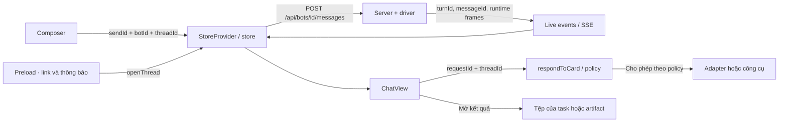

# Mốc trước redesign · 19/11/2026

## Checkout và môi trường

| Mục | Quan sát |
|---|---|
| Đích Git | `https://github.com/tigerthong1102/MoonBot.git`, nhánh mặc định `main`, sau fetch `84a401a03b7de9d02b28d7633d966a9faeae2e3d` |
| Quyền và rules | GitHub trả `viewerPermission=ADMIN`, `protected=false`, rules áp dụng cho main là `[]`. Gate do chủ sản phẩm yêu cầu vẫn áp dụng |
| Checkout ban đầu | Sạch, nhánh `build/startupbot-internal-desktop-20261118`, HEAD `960b66b33`. Tạo worktree khác từ SHA của main. Các worktree đang dùng được giữ nguyên |
| PR khác đang mở khi lấy mốc | [#33 · phiên bản desktop](https://github.com/tigerthong1102/MoonBot/pull/33), [#36 · bộ cài Windows ARM64](https://github.com/tigerthong1102/MoonBot/pull/36) |
| Runtime | Darwin 25.6 arm64 · Node 26.4.0 (manifest ≥24, CI Node 24) · lockfile pnpm v9 · pnpm 10.33.0 · Electron 43.7.9 |
| App | `electron/main.mjs`, `electron/preload.cjs`, renderer React/TypeScript qua Vite. `contextIsolation`, `window.ogb`, app ID `ai.startupbot.desktop`, scheme `startupbot`. Main window tối thiểu 840 × 620 |
| CI trên base | [CI](https://github.com/tigerthong1102/MoonBot/actions/runs/44475620524) thất bại. [Windows shard 5/8](https://github.com/tigerthong1102/MoonBot/actions/runs/44475620524/job/135395985083) timeout 60.000 ms ở corpus kế toán 10.000 ca của `scripts/testing/mock-accounting-rpa.test.mjs`. Packaged **server** smoke Windows đạt |

## Ai sở hữu dữ liệu và thao tác

| Đối tượng | Ranh giới ở base | Đích trong thiết kế B |
|---|---|---|
| Conversation/session | Bot và task có `threadId`. Store hydrate transcript, reconcile gửi lạc ACK theo ID. Server/driver giữ phiên provider. Nhóm có đường gửi riêng | Lịch sử và chat dùng lại thread cũ, tiếp tục hội thoại theo `botId/threadId` |
| Task/run | `Composer.tsx` dispatch send, `state/store.tsx` gửi HTTP. `turn-status.ts` nhận `turn.started/progress/completed`. Task có thể có nhiều lượt. Routine có run ID riêng | Công việc dùng ID gốc khi mở chi tiết. Phải kiểm run đồng thời, hủy, lỗi và hoàn tất trái thứ tự trước tích hợp |
| Approval | Thẻ và request chờ thuộc server; phản hồi đi đến `POST /api/threads/:id/respond`. Full Access dùng cơ chế grant hiện hành của Electron | Trang chủ/Công việc đưa người dùng tới đúng thẻ. Runtime quyết định có cần duyệt và có được thực thi |
| Artifact | Tham chiếu tin nhắn/tệp và thư mục task do server giữ; trình mở tệp native đi qua preload/main | Kết quả mở từ việc hoặc hội thoại; khi thất lạc cần giữ thông tin phiên và báo thiếu tệp |
| Agent/team/package | Bot profile, team, thư viện và package đã có. Preload có pending package install và chat link | Nhân viên AI chọn đúng người nhận. Giữ đường import, hướng dẫn, kỹ năng, workflow và lịch từ chi tiết cũ |
| Apps/connector | `connected-apps.ts`, các trang Apps và thiết lập cho bot dùng registry/server; quyền kết nối và quyền gửi có thể khác nhau | Ứng dụng là lối mở chi tiết và cấu hình. Mở trang xem dữ liệu không khởi chạy đồng bộ |
| Schedule | Server quản lý routines, triggers, calendar, run history và trạng thái enabled | Lối vào lịch qua Công việc và chi tiết nhân viên. Nhập gói phải giữ lịch tạm dừng |
| Settings | Local storage của renderer giữ tùy chọn giao diện. Config workspace, mode từng thread/bot, policy server và thiết lập native có phạm vi riêng | Cài đặt mở màn hiện hữu theo phạm vi. Widget và preset là nhóm cấu hình mới có thể hoàn tác độc lập |

**Điểm gắn shell dự kiến.** `src/main.tsx` có nhánh `/home` cho `HomeScreen` và bridge Cloud. `src/App.tsx` điều phối sidebar, nhóm, chat, files, team-map, web-panel, published-apps, routines, settings, notification rail và các panel song song. Giữ một owner của store/SSE, của external chat links và notification opens ở trên phần điều hướng. Các chi tiết chat, ApprovalCard và ComputerPanel dùng lại khi implement. Dev Electron tải địa chỉ fixture qua `ELECTRON_START_URL`; luồng gửi đã quan sát là HTTP + SSE.

**Lối vào cần giữ khi tích hợp.** Sidebar hiện có tìm kiếm, tạo/chia sẻ, Hộp thư, mở bot và cài đặt. Menu/palette và phím tắt tiếp tục điều hướng đến view cũ. Các màn files, web/browser, ứng dụng đã xuất bản và lịch cần mở được qua Công việc hoặc Ứng dụng. Team-map và thiết lập riêng của bot mở qua Nhân viên AI. Thông báo, liên kết chat/package từ preload và menu Settings từ main cần tiếp tục định tuyến theo ID. Trang chủ mới chỉ vào sau khi điều hướng Cloud, đăng nhập và onboarding đã được giải quyết.

## Dữ liệu cũ và khôi phục

`src/lib/interface-mode.ts` đọc `omb-advanced-mode` với lựa chọn `1/0`, rồi dùng dấu hiệu prior run nếu thiếu. Trên fixture sạch đã quan sát `0`. Bản thiết kế lấy Nâng cao làm mặc định cho người mới. Khi implement cần tôn trọng lựa chọn được lưu riêng với quyền Full Access.

`omb-skin` hỗ trợ `system` và các skin Midnight, Atelier, Foundry, Lagoon, Graphite, Linen, Dusk, Daylight, Meadow, Pop, Halloween, Diwali, Aurora. Theo hệ thống ánh xạ Daylight/Midnight. Renderer đọc cache `omb-theme`. Import/export `.mausbot-theme.json` dùng schema trong `shared/theme.ts`; có skin, canvas, accent, token, biến thể sáng/tối, font và CSS. Lịch sử theme phía server giữ tối đa 30 thay đổi. `?safe-look` đặt `omb-safe-look` của session và bỏ qua custom theme. Phím reset look hiện có là Cmd+Option+Shift+R hoặc Ctrl+Alt+Shift+R. `omb-drafts`, `omb-send-key`, `omb-show-threads` và các khóa backup được giữ theo hợp đồng cũ. Shell sản phẩm cần lối cứu hộ trước renderer riêng với reset look. Giai đoạn này không có migration.

## Electron baseline trên macOS

Main và preload thật chạy qua binary Electron của lockfile, nhận renderer từ `dist` trên server fixture loopback. Server dùng `verificationServerEnvironment`/fake Claude. Mỗi desktop dùng `--user-data-dir` riêng. Mốc profile cũ được tạo bằng chính bản trước redesign, sau khi đổi theme, gửi tin, lưu lịch tạm dừng, đóng server và Electron. Mỗi nhóm kiểm dùng bản sao. Không đưa profile, token, dump provider hay log thô vào Git.

| Ca | Phạm vi quan sát trên base | Kết quả |
|---|---|---|
| S01 | Khởi động với userData mới, preload hiện diện, trang có nút/composer tương tác, hoàn thành onboarding bằng chuột rồi gửi bằng phím. 2.225 ms từ lúc spawn Electron dev đến control đầu tiên, server đã sẵn sàng. macOS có dòng Chromium `task_policy_set ... invalid argument (4)`; app tiếp tục chạy | PASS. Lượt profile sạch thứ hai giữ phản hồi HTML ở proxy tới khi gắn error/rejection listeners, xác nhận bridge, Tab và click Next. 0 renderer errors, 0 unhandled rejections |
| S02 | Mở lại bản sao hai lần, đúng bot/thread, đường dẫn workspace còn tồn tại, giữ Full Access và Midnight. Theo dõi đúng routine ID, enabled=false và 0 run. Gửi tin tiếp trong lần mở thứ nhất, tìm lại ở lần thứ hai | PASS · 940 ms và 914 ms đến tin đã lưu sau khi server sẵn sàng |
| S03 | Nhấp đúp nút Gửi, vào Cài đặt khi còn stream, quay lại chat. Fake CLI có counter riêng, HTTP có sendId. Một POST, một lượt ở fake CLI, một tin user lưu trong cùng thread, thấy trọn phản hồi | PASS · pageErrors=0 trong lượt gửi |
| S04 | Hủy qua nút Dừng, runtime trả 200, busy về false. Gửi lượt khác được 202, ngắt mạng renderer, nối lại và reload, đúng tin user và reply. Hai đường gửi tạo tổng cộng hai POST. Lượt tiếp theo cắt socket SSE ở proxy loopback khi đang stream rồi cho mạng trở lại. Số kết nối mở tăng 1 → 2, UI nhận đủ reply không reload. Bộ đếm adapter = 1, số POST = 1, feed có 3 ID duy nhất | PASS cho hủy, tự nối lại và feed. Banner ở Notification Center của hệ điều hành chưa được đếm |
| S05 | Mở chat, màn hình máy tính của bot, Hộp thư và Cài đặt qua nút ở giao diện cũ. Chat đã lưu hiển thị khi mở lại | PASS cho các điểm vào baseline. Sáu điểm đến của B mới có ở prototype |
| S06 | Đổi Giao diện → Tối bằng control thật, đóng hẳn. Trong hai lần khởi động lại, localStorage và skin thực tế đều là Midnight; đúng thread và quyền | PASS. Widget mới chưa có trên baseline |
| S07 | Fixture connector loopback có bộ đếm. Full Access thực hiện 1 lần. Chuyển sang mode hỏi, ở hai request riêng mở thẻ thật trong Electron: trước duyệt 0, sau từ chối 0, sau cho phép 1. Kiểm kết quả ở adapter | PASS cho fixture trên macOS. Chưa xác minh MISA production read-only |

Ca S03 dùng `sendId=599ed62c-6b76-4d4a-81bd-e782b219ba6b`, `threadId=ef29d2ef-324d-4829-8746-13e1d0dd9496`, `messageId=767692fc-7a54-425f-91ca-00ee202d5f6c`. Các ID này thuộc fixture tổng hợp.

**Hiệu năng lịch sử dài.** Harness hiện hữu dùng Chrome headless trên cùng máy Mac, 45 bot, 100 thread, 1.000 tin, Advanced. Server sẵn sàng sau 1.792 ms. Lần tải vào hội thoại mặc định đạt sidebar/transcript ở 395 ms; harness ghi `bigConversationShown=false` cho lần tải đó. Bốn lần chuyển sau đó mất 79/164/41/73 ms. P95 frame trong bài cuộn là 18,1 ms. Đo lại cùng fixture và cấu hình ở PR bật mặc định.

**Vướng mắc trong quá trình đo.** Cấu hình chặn DNS ban đầu của harness đã chặn cả IP loopback, sửa ngoại lệ trước khi đo. Một lượt điều khiển onboarding gặp nút đang rời DOM. Một dialog chọn chế độ cũ che thẻ quyền, đóng bằng Escape trước khi thao tác lại. Benchmark lớn cần tăng heap Node lên 8 GiB và cung cấp đường dẫn Chrome. Các lần thất bại đầu được giữ trong evidence cục bộ.

## Lệnh và bằng chứng kiểm

- `pnpm install --frozen-lockfile`, `pnpm lint`, `pnpm typecheck`, `pnpm build`, `pnpm build:server` đã chạy.
- `pnpm exec vitest run src/lib/skins.default.test.ts src/lib/interface-mode.test.ts src/lib/new-look.test.ts` đạt 31 test. `pnpm exec vitest run server/full-access-workflows.e2e.test.ts` đạt 1 test. `pnpm exec vitest run server/trust-controls.e2e.test.ts` đạt 25 test. `pnpm exec electron scripts/smoke-approval-modes.cjs` đạt private grant, chuyển mode và UI fixture.
- Khởi động desktop dev phục vụ smoke bằng `electron . --user-data-dir=<fixture> --remote-debugging-port=<port-riêng>` với `ELECTRON_START_URL` trỏ server fixture đã build. Kiểm tra CDP sóng đôi với ID và counter ở runtime. Repo còn có `pnpm dev:desktop`, `pnpm test:electron`, `pnpm test:packaged-server` và `pnpm test`. Script tên `integration` và script gom toàn bộ S01–S07 chưa có. Toàn bộ `pnpm test` chưa chạy cục bộ.
- Đo lịch sử với `NODE_OPTIONS=--max-old-space-size=8192 node --experimental-strip-types scripts/bench-desktop.ts --only big --advanced --chrome '/Applications/Google Chrome.app/Contents/MacOS/Google Chrome' --bots 45 --threads 100 --messages 1000 --out <report.json>`. [Số đo đã lọc](measurements.json).
- macOS dev đã mở ứng dụng thật. Windows desktop dev, Windows/macOS packaged, round-trip import theme, lối cứu hộ từ ngoài renderer, độ bền các connector/workflow/schedule/computer-use kế toán và smoke trước/sau merge vẫn thuộc các gate triển khai. Không có PR sản phẩm nào được merge ở bước duyệt thiết kế.

## Ranh giới pilot và rollback

Bản HTML không khởi chạy provider, gọi preload, truy cập MISA, gửi email hoặc đăng bài. Nguồn kế toán, kết quả và lỗi chỉ đọc là dữ liệu mô phỏng hiển thị để duyệt. Chưa có đường production nào được mở cho pilot. Trước khi mở một đường, cần thử ở fixture riêng với agent Full Access và kiểm tại ranh giới nguồn. Các đường connector, workflow, lịch và điều khiển máy phải được xem xét độc lập. Đường nào chưa chặn được ghi từ đầu đến cuối tiếp tục nằm ngoài pilot.

Đóng bản xem thử để quay lại desktop đang dùng. Lối cứu hộ shell trong bản cài sẽ có PR, test và phê duyệt riêng trước khi bật mặc định.
