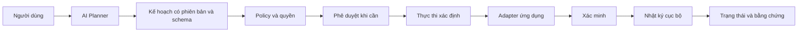

# ADR — Một bộ thực thi, nhiều adapter và Skill

Trạng thái đề xuất. Phạm vi triển khai lần đầu gồm qualification Windows và thử kế toán với dữ liệu tổng hợp trong fixture cô lập.

## Quyết định

- Mở rộng Saved Steps dần tại `server/saved-steps`. Giữ `ComputerCaller`/MCP gate làm cổng host Windows, journal, resolver và các event hiện có. Browser adapter gọi backend trong `server/browser/` với origin, profile và frame chính xác. Fixture kế toán thực thi contract bằng adapter giả độc lập, chưa nối route/chat hay thêm input engine.
- Adapter registry do code kiểm soát. Mỗi mục khai báo vendor, product, edition, version/build đã kiểm thử, executable hoặc package/origin identity, surface, capability, selector và pre/postcondition. Một profile Windows cần cấu hình delivery mode, dấu hiệu modal/focus và fingerprint công ty. Dùng tên hiển thị làm gợi ý khám phá. Khi có hai ứng viên hoặc thiếu định danh đáng tin cậy, chặn hoạt động. Kiểm lại PID, HWND, trạng thái cửa sổ, scope và token ngay trước thao tác sau lần chờ approval.
- Workflow JSON schema có phiên bản, input schema bị giới hạn, precondition, action và wait được allowlist, postcondition, verifier, error handling, permissions, recovery và provenance. Các operator được biên dịch thành gọi hàm xác định, giới hạn thời gian và số bước. Skill có thể đóng gói file workflow nhưng Markdown, file nhập theo bot và output AI đều là dữ liệu chưa có quyền điều khiển. Digest SHA-256 của bản chuẩn hóa và adapter/profile phải khớp bản đã duyệt trong local trust store. Cần fail closed với schema chưa biết, field lạ, digest lệch và quyền hết hạn hoặc đã thu hồi.
- Grants ghi bot, machine, actor, company, capability, workflow digest và expiry. Kiểm khi nhập, trước từng action, sau mỗi approval và trước commit. Approval bind cả scope lẫn hash dữ liệu dự kiến. Phân loại `read-only`, `draft`, `write`, `irreversible`. Windows qualification chỉ cho phép navigation fixture. Bản thương mại cần chính sách rõ cho việc `Full access` của chat và các tình huống UAC, CAPTCHA, OTP hoặc modal ngoài dự kiến.
- Tool call có timeout, cancellation và số lần quan sát giới hạn. Dùng polling cho wait, sai target hoặc điều kiện tiền đề thì dừng. Kiểm hậu điều kiện trên snapshot mới sau thao tác. Khi kết quả mơ hồ dùng xác minh độc lập qua nguồn chỉ đọc thích hợp. Retry quan sát có thể an toàn, retry thao tác ghi phải qua journal và đi theo giải quyết riêng.
- Giới hạn log theo mã bước, trạng thái, thời lượng và số lượng. Dữ liệu nằm cục bộ theo mặc định. Approval digest, khóa idempotency và event audit dành cho local runtime có ACL. Hạn chế lưu title/label, screenshots, và value thực. Biện pháp thu hồi, retention và xóa cần có trước pilot thật.

## Hợp đồng kế toán

Mẫu kiểm tra dùng số nguyên đơn vị tiền nhỏ nhất từ chuỗi decimal chuẩn hóa, danh mục tài khoản và đối tượng đã xác nhận, company/niên độ/kỳ, ngày Việt Nam, trạng thái khóa sổ, quyền, định danh và trùng chứng từ. Đọc nguồn đã lưu và so khớp toàn bộ nội dung nghiệp vụ, gồm từng dòng, tài khoản, chiều Nợ/Có, đối tượng và tiền.

`PLANNED → VALIDATED → AWAITING_APPROVAL → EXECUTING → VERIFYING → VERIFIED` là nhánh thành công. `BLOCKED` dành cho điều kiện hoặc quyền thiếu trước dispatch. `UNKNOWN` dành cho dispatch có khả năng xảy ra hoặc chưa có bằng chứng đủ để phân biệt, kể cả restart trong lúc ghi. `FAILED` dùng khi xác định được lỗi, ví dụ dữ liệu đã lưu sai khi đọc lại. Tất cả các trạng thái từ dispatch phải có chính sách lưu journal bền trước side effect.

Khóa idempotency phải ổn định theo company, niên độ, loại và định danh chứng từ. Khóa duy nhất và kiểm duplicate đang lưu phải được giữ qua restart. Nếu mất response hoặc crash, lần sau chỉ được đọc lại bằng khóa đã giữ. UI RPA không hứa rollback DB. Khi dữ liệu thực tế lệch, giữ bằng chứng và chuyển xử lý thủ công.

## Teach & Learn

Người dùng chọn ứng dụng, scope và bắt đầu/kết thúc phiên một cách chủ động. Prototype tương lai nhận sự kiện từ nguồn quan sát đã giới hạn hoặc tool call đã lọc, rồi rút gọn thành đề xuất workflow Draft. Chỉ lưu selector và biến input đã định danh. Không thu bí mật, OTP, mật khẩu hoặc app khác. Lưu xóa phiên và draft theo cùng ID, hiển thị chính sách giữ và xóa bản ghi. Chạy draft trên dữ liệu tổng hợp, review revision/digest, cấp grant giới hạn sau acceptance. Một ví dụ thao tác chỉ truyền quy trình UI, mọi quy tắc hạch toán phải đi qua validation được xác nhận. Theo tag 0.45.4, recorder có phạm vi trajectory của tool call và có thể tạo ảnh trước/sau, vì vậy chưa có cơ sở dùng làm observer thao tác người dùng trong phiên thật.

## Các lần bàn giao

| Đợt | Phạm vi và điều kiện nối tiếp |
|---|---|
| A | Audit, ADR, license inventory. Review trạng thái thật theo từng cấp bằng chứng. |
| B | Qualification native MCP đã ghim version, fixture Windows cô lập, contract test. Cần evidence thật trước khi đưa capability vào profile. |
| C | Saved Steps Windows mặc định đóng. Chỉ thử bật nội bộ khi review trường hợp window/token/state sau restart, không có hành động ghi và CI tương tác đạt. |
| D | Schema, mock kế toán, validation, journal, approval và verification. Chưa gắn vendor hoặc route sản phẩm. |
| Sau D | Teach & Learn có nguồn sự kiện giới hạn được. Mỗi vendor cần xác minh riêng về phần mềm, build và demo được phép dùng. |

Ma trận Windows tối thiểu gồm Win10/Win11 x64, scale 100/125/150%, nhiều độ phân giải, ít nhất hai màn hình, cửa sổ trùng tên, mất foreground, dialog modal, tiếng Việt/Anh, WinForms/WPF và control tự vẽ. Từng tổ hợp ghi phiên bản OS, driver, app, DPI và kết quả đã đọc lại. CI Server và fixture mock là các job riêng. Chặn rollout Windows nếu không lấy được identity, tree/action evidence đủ tin cậy.

Đo baseline AI theo từng bước và workflow xác định trên cùng fixture, cùng input và oracle, với warm/cold được ghi rõ. Ghi số lần AI, input/output tokens, CUA calls, milliseconds từng bước và tổng, xác minh, retry, UNKNOWN, can thiệp người dùng. Tách token từ provider telemetry và CUA từ MCP, dùng đa lần chạy và báo phân bố. Mẫu mock không cung cấp baseline chi phí hay latency Windows.

Kiến trúc giữ CUA-only và hạ tầng Skill đang có. Nếu cần thêm đường điều khiển input, mở ADR mới để đánh giá an ninh, bản quyền, quyền Windows và migration. Rà installer cuối để có LICENSE, NOTICE, SBOM/attribution cho đúng binary, SDK và asset trước phân phối.
